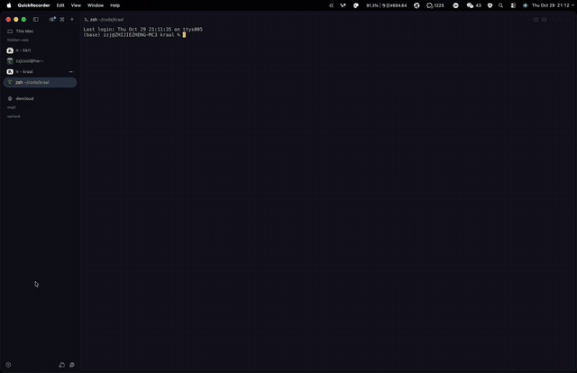

# krd — kitty remote desktop

English | [简体中文](README.zh-CN.md)

[](https://github.com/zzjcool/krd/actions/workflows/ci.yml)
[](https://github.com/zzjcool/krd/releases)
[](#license)
[](#requirements)

**A macOS desktop inside a terminal pane.** ScreenCaptureKit grabs the screen, the picture goes
out as kitty graphics escapes on stdout, and mouse/keyboard events come back on stdin and are
injected with `CGEvent`.

No VNC, no codec, no second port — the terminal you are already sitting in *is* the client.

## Demo

<!-- docs/media/demo.gif is the recorded session; the block below degrades to alt text if the file is not there yet -->
<p align="center">
  
</p>

<p align="center"><sub>Desktop in an SSH pane. Only the tiles whose pixels changed are re-sent — a static screen sends nothing at all.</sub></p>

## Why

| | VNC / RDP / remote-desktop app | krd |
|---|---|---|
| Client | an app to install on every machine you view from | the terminal you already have — any SSH session |
| Network | a listener plus a port forward or VPN | nothing: escapes on stdout, keystrokes on stdin |
| Auth | its own password / TLS setup | whatever your SSH already does (keys, 2FA, bastion, `ProxyJump`) |
| Compression | a video codec | zlib on screen regions that actually changed |
| Input | its own protocol | SGR mouse reports + keys → `CGEvent` |

Concretely: a typical UI change (one glyph, a button highlight, a caret) touches **1–2 tiles =
1–5 KB**; an idle desktop costs **0 bytes/s**, because identical frames are dropped before they
reach the encoder.

## Requirements

- **macOS 14 (Sonoma) or newer** on the machine being viewed (`Package.swift` pins `.macOS(.v14)`).
- A terminal that implements the **kitty graphics protocol** on the viewing side — see the
  [compatibility matrix](#terminal-compatibility). Apple Terminal.app does not.
- Xcode command line tools to build (`swift build`). No Swift toolchain is needed on the remote
  Mac if you ship the binary.
- Screen Recording + Accessibility permission on the machine being viewed (one-time, see
  [deploying to another Mac](#deploying-to-another-mac)).

## Install

### Build from source

```bash
git clone https://github.com/zzjcool/krd && cd krd
swift build -c release                     # → .build/release/krd
.build/release/krd --selftest --no-input   # synthetic picture, needs no permissions at all
```

### Install a signed binary (recommended)

```bash
./install.sh          # build → ~/bin/krd → re-sign with a stable identity
```

`install.sh` copies the binary to a fixed path (`~/bin/krd`) and signs it with the first
`Apple Development: …` identity it finds, falling back to ad-hoc with a warning. Signing is not
cosmetic: macOS records the Screen Recording grant **against the code signature**, so an ad-hoc
build gets a new cdhash on every recompile and the permission stops matching
(`-3801 The user declined TCCs`). One signature, one approval. Pick a specific identity with
`KRD_SIGN_IDENTITY="Apple Development: …" ./install.sh`.

### Deploy to another Mac

```bash
./deploy.sh user@host              # → ~/bin/krd on that host
./deploy.sh user@host /usr/local/bin/krd
```

Builds a universal (arm64 + x86_64) binary, signs it here with the same identity, and streams it
over `cat | ssh` so the signature survives the copy. Full walkthrough, including the two TCC
prompts: [docs/DEPLOY.md](docs/DEPLOY.md).

Prebuilt binaries are attached to every
[release](https://github.com/zzjcool/krd/releases) as
`krd-vX.Y.Z-macos-universal.tar.gz` plus a `.sha256`. They are **not** signed with your identity, so
sign one locally (`codesign --force --sign "…" --identifier com.kkrt.macdesk krd`) before the first
run, or the TCC grant will not survive the next update.

## Usage

```bash
krd --list                        # displays and windows, then exit
krd                               # the display under the pointer, 20 fps
krd --display 1 --fps 30          # a specific display (index from --list)
krd --window "Mail"               # mirror a single window (id or title substring)
krd --no-input                    # watch only, no injection
krd --debug                       # stats + geometry + input trace, written to a file
```

Over SSH:

```bash
ssh -t user@host ~/bin/krd --fps 20 --debug
```

`-t` is not optional. Without a tty on stdin, input is disabled (krd says so and leaves mouse
reporting off, otherwise your terminal's reports would be echoed onto the picture) and the pane
falls back to 80×24 cells, which gets the aspect ratio wrong.

**Ctrl-\\ quits.** Ctrl-C is forwarded to the remote desktop, exactly like sitting in front of it.

### Options

Every flag below is parsed in `Sources/krd/main.swift`; the table is the `--help` text plus the
defaults and clamps as they are actually applied.

| Flag | Default | Meaning |
|---|---|---|
| `--fps <n>` | `20` | capture rate cap; clamped to ≥ 1, applied as `minimumFrameInterval = 1/n` |
| `--display <i>` | pointer's display | display index as printed by `--list`; out-of-range falls back to the display under the pointer, then the main display, then the first one |
| `--window <q>` | — | capture one window: numeric window id, or a case-insensitive title substring; candidates must be larger than 40×40 pt |
| `--tile <c>x<r>` | `16x8` | dirty-tile size in terminal cells; `c` clamped to ≥ 2, `r` to ≥ 1 |
| `--cell <w>x<h>` | `8x20` | cell size in pixels used when the terminal reports no pixel size for the pane |
| `--log <path>` | `$TMPDIR/krd-<pid>.log` | write diagnostics to this file instead of over the picture; implies file logging |
| `--full-frame` | off | disable tiling and re-send the whole frame every time (comparison / debugging) |
| `--no-input` | off | do not open stdin, do not inject events |
| `--dry-run` | off | parse input and log it, never post a `CGEvent`; pair with `--debug` or `--log` so the trace lands in a file, not on the picture |
| `--debug` | off | file logging + 1 Hz stats + geometry dump + input tracing + accessibility status |
| `--selftest` | off | synthetic picture through the real tile pipeline; no ScreenCaptureKit, no permissions |
| `--list` | off | print displays and windows, then exit (needs Screen Recording) |
| `-h`, `--help` | — | print usage and exit |
| `-v`, `--version` | — | print the version (`krdVersion`, kept in sync with the `VERSION` file) and exit |

`--tile 8x4` gives 8×4-cell tiles (more, smaller updates); `--tile 32x16` gives fewer, bigger
ones (less protocol overhead per update, more bytes per change). The default 16×8 is what the
measurements below were taken with.

### Environment variables

Diagnostic switches, all read once at startup. They are documented one by one in
[docs/TESTING.md](docs/TESTING.md).

| Variable | Effect |
|---|---|
| `KRD_DUMP=<path>` | write every byte krd emits to that file (offline protocol diffing) |
| `KRD_GRID=1` | selftest only: one colour + white border per tile, to check placement |
| `KRD_QUADRANTS=1` | selftest only: four placement variants, one per screen quadrant |
| `KRD_Q=0` | stop suppressing protocol replies (see `OK` / `EINVAL` / `ENOENT`) |
| `KRD_NOSYNC=1` | drop the per-tile `?2026` synchronized-update wrapper |
| `KRD_DELTEST=1` | selftest + quadrants only: send one lone `a=d,i=901` and see what it destroys |
| `KRD_NO_NSAPP=1` | do not create the `NSApplication` context (reproduces a ScreenCaptureKit failure mode) |
| `KRD_SIGN_IDENTITY` | identity used by `install.sh` / `deploy.sh` |

## How it works

```
 your machine                              the Mac being viewed
┌──────────────────────────┐              ┌──────────────────────────────────────────────┐
│ terminal pane            │              │  sshd ── pty ── stdout ──▶ krd               │
│  rex / Ghostty / kitty   │              │                  stdin  ◀──                 │
│                          │              │                                              │
│  draws APC images  ◀─────┼──── ssh ─────┼── kitty graphics escapes                     │
│  reports mouse/keys ─────┼──── ssh ─────┼──▶ SGR reports ──▶ CGEvent ──▶ desktop      │
└──────────────────────────┘              │                                              │
                                          │  ScreenCaptureKit ──▶ BGRA ──▶ RGBA ──▶ tiles │
                                          └──────────────────────────────────────────────┘
```

1. **Capture.** `SCStream` (one display, or one window via `SCContentFilter`) delivers BGRA
   frames at up to `--fps`; `vImagePermuteChannels_ARGB8888` turns them into RGBA in one pass.
   Frames byte-identical to the previous one are dropped here — that is why an idle desktop
   costs nothing. `queueDepth = 3`; the stream delegate logs if the stream dies.
2. **Layout.** The source rect's aspect ratio is fitted into the pane using whole cells only
   (no sub-cell offsets, no resampling surprises): e.g. a 137×73-cell pane with 17×33 px cells
   showing a 1920×1200 pt display becomes a 137×44-cell picture of 2329×1452 px, i.e. 9×6 = 54
   tiles of 16×8 cells.
3. **Dirty tiles.** Each frame is compared tile by tile with `memcmp` (one `memcmp` per tile
   row). Only tiles whose pixels differ are compressed — `compress2()` from the system libz
   (RFC 1950, which is what the protocol's `o=z` wants), base64, and streamed to the terminal in
   4096-character chunks.
4. **Render.** One image id and one placement id per tile, hard-wired to the tile index, so a
   frame simply overwrites the previous placement of the same tile: nothing is ever deleted, so
   no terminal can lose the picture to a delete. Full sequence in
   [docs/PROTOCOL.md](docs/PROTOCOL.md).
5. **Input.** `?1003h` (every motion) + `?1002h` (button events) + `?1006h` (SGR) + `?1016h`
   (SGR **pixels**) on stdin; the coordinates are mapped through the same layout back to screen
   points and posted as `CGEvent`s. Pixel coordinates are what make a 12-point traffic-light button
   clickable; any-motion tracking is what makes the pointer follow the mouse without clicking.

### Geometry, the three layers

```
terminal cell  ──▶  image pixel  ──▶  screen point (CGEvent space)
      ▲                    ▲
      │                    └─ TileGrid: whole cells, edge tiles are smaller
      └─ CSI 16t / CSI 14t  →  TIOCGWINSZ  →  --cell (first one that answers wins)
```

- `TermGeometry.query()` asks the terminal directly (`CSI 16 t` for the cell size, `CSI 14 t` for
  the window size, 250 ms timeout). sshd ptys report `0` for `ws_xpixel`/`ws_ypixel`, so this is
  the only way to get a truthful pixel size over SSH.
- Falls back to `TIOCGWINSZ` on stdout → stdin → `/dev/tty`, and finally to `--cell` (`8x20`
  by default).
- `TileGrid.make()` fits the source aspect into the pane in whole cells; `TileGrid.rect()` rounds
  each tile's pixel rect so tiles tile the picture exactly, with narrower/shorter edge tiles.
- `Viewport.point(forCell:)` maps a cell to the **centre** of that cell; `Viewport.point(forPixel:)`
  maps pixels linearly across the placement. Events outside the placement are dropped.

### Input

- Mouse: `?1003h` (every motion) + `?1002h` (press / drag / release) + `?1006h` (SGR encoding) +
  `?1016h` (pixel coordinates). Only the left button is synthesized: press → `leftMouseDown`, motion
  with a button down → `leftMouseDragged`, button-less motion (`b & 3 == 3`) → `mouseMoved`, the `m`
  final byte → `leftMouseUp`. Wheel (`b & 64`) becomes a line-based `scrollWheelEvent` — up is +1,
  down is -1.
- **Downgrade rule.** A cell coordinate can never exceed the terminal's grid, so any report whose
  x or y is larger than `cols`/`rows` must be in pixels; that latches a sticky `pixelMouse` flag.
  Terminals that ignore `?1016h` keep sending cells and keep using the cell mapping. Both paths
  are correct, pixels are just 17×33 times more precise.
- Keyboard: CSI arrows / Home / End / `~` sequences with modifier bits, SS3 arrows and F1–F4,
  Backspace/Tab/Enter, Ctrl-A … Ctrl-Z, printable characters through a US/ANSI virtual-keycode
  map (shifted symbols add `maskShift`), anything else as a Unicode-string key event. Alt+key
  arrives as `ESC`+key and maps to `maskAlternate`.
- The tty is put in raw mode (`ECHO|ICANON|ISIG|IEXTEN` off, `IXON|ICRNL|BRKINT|INPCK|ISTRIP`
  off, `OPOST` off, `CS8`, `VMIN=1`, `VTIME=0`) and restored on exit, so the remote desktop sees
  every keystroke and nothing is echoed twice.

## Measured numbers

Mirroring a 1920×1200 pt display into a 137×73-cell pane (17×33 px cells → 2329×1452 px picture,
9×6 = 54 tiles), from the `--debug` `stats:` line:

| Scenario | tiles/s | dirty tiles | last frame | bytes/s | zlib |
|---|---|---|---|---|---|
| idle | 0 | 0 | 0 KB | 0.00 MB/s | — |
| typing / scrolling text | 113 | 1 | 8 KB | 3.88 MB/s | 1 ms |
| dragging a window | 157 | 43 | 2395 KB | 9.18 MB/s | 128 ms |

`tiles/s` is tiles emitted per second (not frames), `last frame` is the compressed payload of the
most recent frame, `bytes/s` is everything written in the last second.

Before tiling — one full frame per update — the same pane cost 430 KB/frame, 12.6 MB/s and 48 ms
of zlib per frame. Tiling cut that by an order of magnitude and made compression cost
proportional to the area that actually changed.

Protocol-level measurements (terminal pipe throughput, per-tile sizes, end-to-end bandwidth
budget) are in [docs/research-terminal-remote-desktop.md](docs/research-terminal-remote-desktop.md).

## Terminal compatibility

| Terminal | Status | Notes |
|---|---|---|
| **rex** | ✅ | verified end to end: picture, click (including window traffic lights), drag, keyboard |
| **Ghostty** | ✅ | picture and input |
| kitty, WezTerm | ✅ expected | standard implementations of the protocol; not individually regression-tested here |
| **Herdr 0.9.5** | ⚠️ | its `a=d` handling drops the whole image set; krd never sends a per-tile delete, so it should work, but it is not in the regression list |
| Apple **Terminal.app** | ❌ | no kitty graphics protocol — it prints the escapes as text |

To test an unknown terminal, use the calibration modes in [docs/TESTING.md](docs/TESTING.md)
(`--selftest`, `KRD_GRID=1`, `KRD_QUADRANTS=1`); they need no permissions and no second machine.

## Known limitations

- **No kitty keyboard protocol** (`CSI > 9 u`). Bare modifier presses (holding Shift alone),
  key-release events and Cmd combinations are not available; Alt+key works via the ESC prefix.
- **No non-US layouts guaranteed.** Characters are mapped through US/ANSI virtual keycodes;
  anything unmapped is posted as a Unicode string, so **IME input (Chinese, Japanese, …) is not
  supported**, and dead keys are not either.
- **Mouse: all three buttons**, plus double/triple click (`clickState` is derived from timing and
  distance, like the real thing) and the modifiers the terminal reports in the button code
  (`& 4`/`& 8`/`& 16` → Shift / Option / Control). Pointer motion is forwarded too (`?1003h`
  → `mouseMoved`), so hover and cursor-following work — provided the terminal implements
  any-motion tracking. No drag-and-drop between apps, no pressure/force events.
- **No clipboard**, no drag-and-drop, no file transfer.
- **Window mode is capture-only.** `--window` filters the *capture*; clicks are still posted
  globally, so a window covered by another window does not receive them
  (`CGEventPostToPid` is on the roadmap).
- **Display and window are chosen at startup.** A resize is handled (`SIGWINCH` → re-measure,
  re-layout, restart the stream), but hot-plugging displays or switching the captured window
  needs a restart.
- **Absolute pointer only.** Terminals report absolute coordinates, so there is no pointer lock
  and no FPS-style relative motion — that is a ceiling of the terminal form, not a bug.
- **Wheel is discrete** (buttons 64/65 → line units); no pixel deltas, no inertia.
- **No audio** (`capturesAudio = false`), and the cursor is composited into the frames
  (`showsCursor = true`).
- **The lock screen is black.** ScreenCaptureKit does not hand out pixels for a locked session,
  so the picture freezes/goes black until the Mac is unlocked.
- Performance depends on the link: 1–5 KB per typical change is fine on any SSH session, but
  full-screen motion (video, smooth scrolling over photos) is 400 KB+ per update and wants a
  better encoder — that is what the roadmap is for.

## Deploying to another Mac

Full walkthrough with all the failure modes: [docs/DEPLOY.md](docs/DEPLOY.md). The short version:

```bash
# 1. On the target Mac: System Settings → General → Sharing → Remote Login: on
# 2. From your machine (same source tree, same signing identity):
./deploy.sh user@host              # universal binary → ~/bin/krd on the host

# 3. On the target Mac, once, from its own GUI Terminal (not over SSH):
~/bin/krd --list                   # approve "Screen Recording" when macOS asks
~/bin/krd --fps 20                 # approve "Accessibility" when macOS asks
#    If macOS never asks (it may not, because the process was started over SSH), add the
#    binary manually with "+" under System Settings → Privacy & Security →
#    Screen Recording, and again under Accessibility.

# 4. From now on, from any machine with a kitty-graphics terminal:
ssh -t user@host ~/bin/krd --fps 20 --debug
```

**TCC is the part that bites.** macOS keys Screen Recording and Accessibility on the *code
signature*, so:

- The binary has to be **signed with a stable identity** and stay at a **stable path**. Ad-hoc
  signing (`codesign -s -`) produces a new cdhash on every build; the next run looks like a
  different app and the grant is gone — ScreenCaptureKit then fails with `-3801`, or you get a
  black pane with no error on screen.
- `install.sh` / `deploy.sh` use the same identifier on purpose (`com.kkrt.macdesk`, see the
  comment in `install.sh`): the TCC record is keyed to it, so changing it forces a fresh
  approval.
- Do not `strip`, re-sign, or `mv` the installed binary; rebuild → re-sign → *then* copy, and
  keep the installed path.
- `--list` already needs Screen Recording (it enumerates windows through ScreenCaptureKit), which
  is why it is the safe first run: it either prints your displays/windows or tells you the grant
  is missing, before any pixels are involved.

**It runs on demand.** krd is started by you, in an SSH session, and exits when you press
Ctrl-\\ or close the session. Nothing keeps running afterwards and nothing starts without you; if
you want a second session, you run it again.

## Roadmap

1. **kitty keyboard protocol** (`CSI > 9 u`): bare modifiers, key release, Cmd combinations.
2. **`CGEventPostToPid`** for window mode, so clicks reach a covered window.
3. Clipboard sync (OSC 52), multiple-display hot switch.
4. Codec branch for full-screen motion (e.g. VideoToolbox HEVC) behind a flag — tiling stays the
   default for UI work.

## Documentation

| Document | What is in it |
|---|---|
| [docs/ARCHITECTURE.md](docs/ARCHITECTURE.md) | module map, data flow, threading, layout math, invariants |
| [docs/PROTOCOL.md](docs/PROTOCOL.md) | every escape krd emits or parses, byte by byte |
| [docs/TROUBLESHOOTING.md](docs/TROUBLESHOOTING.md) | the 36 traps this project hit, as symptom → cause → fix |
| [docs/DEPLOY.md](docs/DEPLOY.md) | single-binary deploy, TCC, signature stability |
| [docs/TESTING.md](docs/TESTING.md) | what each diagnostic switch actually verifies |
| [docs/research-terminal-remote-desktop.md](docs/research-terminal-remote-desktop.md) | the original feasibility study and measurements |

## Contributing

Issues and pull requests are welcome. Please read [CONTRIBUTING.md](CONTRIBUTING.md) first — it
lists the build/test commands, the "never write text to the pty" rule and the terminal
calibration routine a new feature is expected to pass.

## Security

krd hands whoever can run it full control of the desktop it runs on, by design. It opens no
socket and authenticates nobody — put it behind SSH. See [SECURITY.md](SECURITY.md).

## License

MIT. See [LICENSE](LICENSE).
